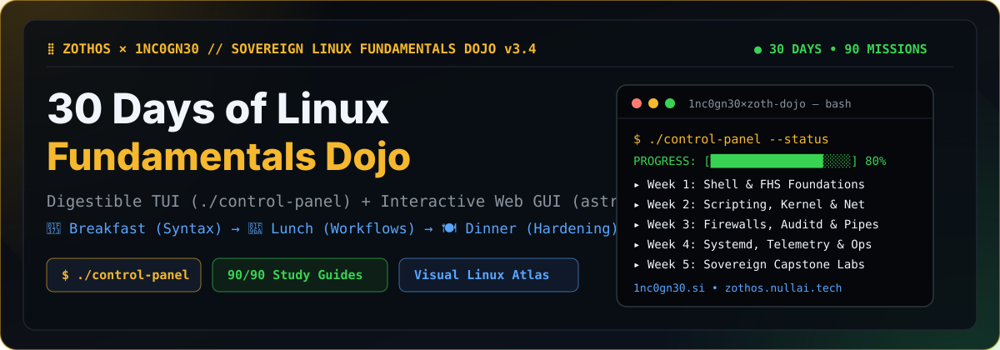
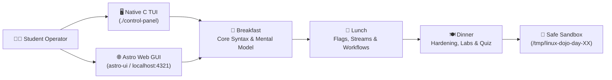
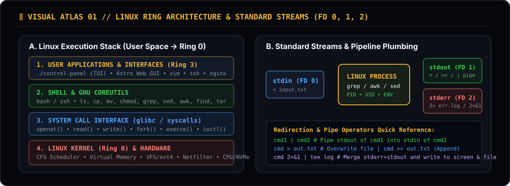
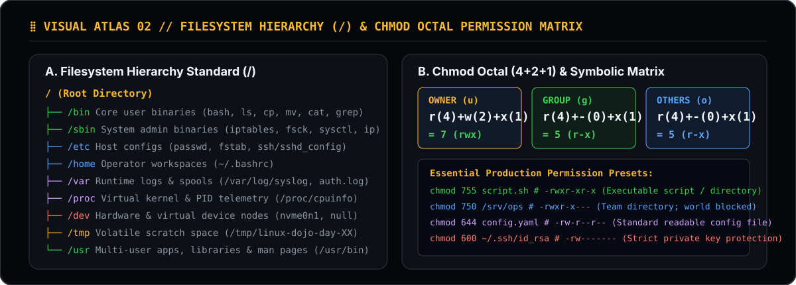
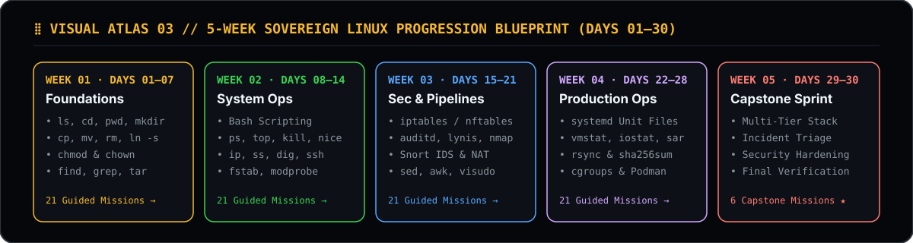

<div align="center">



<br />

# ⣿ 30 Days of Linux Fundamentals — ZothOS × 1nc0gn30 Edition

**Master Linux from Shell Navigation & Permissions to Kernel Modules, Firewalls, Systemd & Production Forensics in 30 Digestible Days.**

[](./30-Days-Of-Linux-Fundamentals-Table-Of-Contents.md)
[-39D353?style=for-the-badge&logo=gnu-bash&logoColor=black)](#1-the-native-c-terminal-tui-control-panel)
[](#2-the-interactive-web-gui-astro-ui)
[](https://1nc0gn30.si)
[](https://zothos.nullai.tech)

</div>

---

## ⚡ Why This Curriculum Works (Zero Fluff, High Retention)

Most Linux courses dump hundreds of man-page flags on you at once. **30 Days of Linux Fundamentals (ZothOS × 1nc0gn30 Edition)** is engineered around **digestible cognitive chunking** and **dual-interface muscle memory**:

1. **The 3-Meal Daily Rhythm (`90 Guided Sessions`)**:
   - **🍳 Breakfast (Morning — Core Syntax & Mental Model)**: Learn 5–8 essential commands with a 60-second visual mental model diagram.
   - **🥪 Lunch (Midday — Operational Workflows & Flags)**: Combine flags, pipes (`|`), and real-world system administration patterns.
   - **🍽️ Dinner (Evening — Hardening, Scripting & Lab Verification)**: Lock in your knowledge with security hardening, troubleshooting scenarios, and interactive quizzes.
2. **Learn Through Both the TUI and the GUI**:
   - **Terminal TUI (`./control-panel`)**: A zero-dependency native C binary with an interactive 30-day navigator, built-in ANSI Markdown study guide reader, Visual Architecture Atlas, Command Cheat-Sheet, Rapid-Fire Flashcard Arena, and 90 compiled C quiz binaries.
   - **Web GUI (`astro-ui/`)**: A browser-based Mission Terminal featuring live command drills, XP & streak tracking, Command Intel cards, an interactive `chmod` Octal Calculator, an interactive Filesystem (`/`) Explorer, and a Pipe (`|`) Simulator.



---

## 🏛️ Visual Linux Architecture Atlas

Before diving into Day 01, anchor your mental model with these three core visual blueprints (also accessible anytime in the terminal via `./control-panel --atlas`):

### 1. Linux Ring Execution Stack & Standard Streams (`stdin 0`, `stdout 1`, `stderr 2`)



### 2. Filesystem Hierarchy Standard (`/`) & `chmod` Octal Permission Matrix



### 3. The 5-Week / 30-Day Progression Blueprint



---

## 🚀 Quick Start: Choose Your Interface (TUI or Web GUI)

### 1. The Native C Terminal TUI (`./control-panel`)

Run the compiled C Dojo Control Panel directly from the repository root:

```bash
git clone https://github.com/1nc0gn30/30-days-of-Linux-Fundamentals.git
cd 30-days-of-Linux-Fundamentals

# Launch the interactive ZothOS × 1nc0gn30 Dojo TUI:
./control-panel

# Or recompile from source anytime with GCC:
gcc -O2 -Wall control.c -o control-panel
```

#### Direct CLI Flags Supported by `./control-panel`:

```bash
./control-panel                # Launch interactive full-screen Dojo TUI
./control-panel --day 1        # Jump straight into Day 01 Mission Dashboard
./control-panel --cheatsheet   # Print the color-coded Master Linux Cheat-Sheet
./control-panel --atlas        # Print the ASCII/Unicode Visual Architecture Atlas
./control-panel --status       # View your 30-day completion bar & Dojo XP
```

```text
╔══════════════════════════════════════════════════════════════════════════════╗
║ ⣿ ZOTHOS × 1NC0GN30 // 30 DAYS OF LINUX FUNDAMENTALS — DOJO TUI v3.4       ║
║ ⠿ Sovereign Terminal & Web Training Deck • 5 Weeks • 30 Days • 90 Missions   ║
╠══════════════════════════════════════════════════════════════════════════════╣
║ [1] 🗺️  30-Day Curriculum Navigator   (Weeks 1–5, C Drills, Guides & Labs)  ║
║ [2] ⚡  Direct Day Jump (Day 01–30)   (Jump to any day's Breakfast/Lunch)   ║
║ [3] 📋  Master Linux Cheat-Sheet      (Files, Perms, Pipes, Systemd & Net)  ║
║ [4] 🏛️  Visual Architecture Atlas     (ASCII FHS Tree, Chmod & Streams)     ║
║ [5] 🎯  Rapid-Fire Flashcard Arena    (Test command recall & earn Dojo XP)  ║
║ [6] 🌐  Web GUI Workstation Info      (Launch Astro UI on localhost:4321)   ║
╚══════════════════════════════════════════════════════════════════════════════╝
```

---

### 2. The Interactive Web GUI (`astro-ui/`)

Prefer learning visually in a browser with interactive command drills, a live `chmod` octal calculator, FHS directory explorer, and YouTube study radio? Launch the Astro Web Workstation:

```bash
cd astro-ui
npm install
npm run dev
# Open http://localhost:4321 in your browser
```

---

## 🗺️ Complete 30-Day Curriculum Matrix (90/90 Study Guides)

Every day contains three compiled C drills (`day-XX-food/{breakfast,lunch,dinner}-day-XX`), C source code (`raw-food/`), and three enriched Markdown study guides (`day-XX-study-guides/`).

### Week 1: Linux Foundations & File Mastery (`Days 01–07`)

| Day | Mission Title | Core Commands | Study Guides (Breakfast / Lunch / Dinner) |
| :--- | :--- | :--- | :--- |
| **Day 01** | Core Shell Navigation & File Operations | `ls`, `cd`, `pwd`, `touch`, `mkdir`, `cp`, `mv`, `rm`, `cat`, `chmod`, `grep`, `ln` | [🍳 Breakfast](week-1/day01/day-01-study-guides/day-01-breakfast-guide.md) · [🥪 Lunch](week-1/day01/day-01-study-guides/day-01-lunch-guide.md) · [🍽️ Dinner](week-1/day01/day-01-study-guides/day-01-dinner-guide.md) |
| **Day 02** | Ownership, Process Control & Disk/Net Telemetry | `chown`, `chattr`, `ps`, `top`, `kill`, `tar`, `df`, `du`, `fdisk`, `netstat`, `ping` | [🍳 Breakfast](week-1/day02/day-02-study-guides/day-02-breakfast-guide.md) · [🥪 Lunch](week-1/day02/day-02-study-guides/day-02-lunch-guide.md) · [🍽️ Dinner](week-1/day02/day-02-study-guides/day-02-dinner-guide.md) |
| **Day 03** | Advanced File Manipulation & Scavenger Pipelines | `touch`, `cp -r`, `mv`, `cd -`, `find`, `grep`, `sed`, `awk`, `locate` | [🍳 Breakfast](week-1/day03/day-03-study-guides/day-03-breakfast-guide.md) · [🥪 Lunch](week-1/day03/day-03-study-guides/day-03-lunch-guide.md) · [🍽️ Dinner](week-1/day03/day-03-study-guides/day-03-dinner-guide.md) |
| **Day 04** | File Viewing, Stream Editing & Text Editors | `cat`, `less`, `more`, `head`, `tail`, `nano`, `vim`, `grep`, `sed`, `awk` | [🍳 Breakfast](week-1/day04/day-04-study-guides/day-04-breakfast-guide.md) · [🥪 Lunch](week-1/day04/day-04-study-guides/day-04-lunch-guide.md) · [🍽️ Dinner](week-1/day04/day-04-study-guides/day-04-dinner-guide.md) |
| **Day 05** | Permissions Architecture, Users & Process Signals | `chmod`, `chown`, `chgrp`, `umask`, `useradd`, `passwd`, `ps`, `top`, `kill`, `nice` | [🍳 Breakfast](week-1/day05/day-05-study-guides/day-05-breakfast-guide.md) · [🥪 Lunch](week-1/day05/day-05-study-guides/day-05-lunch-guide.md) · [🍽️ Dinner](week-1/day05/day-05-study-guides/day-05-dinner-guide.md) |
| **Day 06** | Disk Partitioning, Archiving & Compression | `df -h`, `du -sh`, `fdisk`, `mount`, `umount`, `tar -czvf`, `gzip`, `gunzip`, `zip` | [🍳 Breakfast](week-1/day06/day-06-study-guides/day-06-breakfast-guide.md) · [🥪 Lunch](week-1/day06/day-06-study-guides/day-06-lunch-guide.md) · [🍽️ Dinner](week-1/day06/day-06-study-guides/day-06-dinner-guide.md) |
| **Day 07** | Week 1 Capstone: Shell & Filesystem Mastery Lab | `find`, `xargs`, `tar`, `chmod`, `chown`, `grep`, `awk`, `sed`, `crontab` | [🍳 Breakfast](week-1/day07/day-07-study-guides/day-07-breakfast-guide.md) · [🥪 Lunch](week-1/day07/day-07-study-guides/day-07-lunch-guide.md) · [🍽️ Dinner](week-1/day07/day-07-study-guides/day-07-dinner-guide.md) |

### Week 2: System Operations, Kernel & Networking (`Days 08–14`)

| Day | Mission Title | Core Commands | Study Guides (Breakfast / Lunch / Dinner) |
| :--- | :--- | :--- | :--- |
| **Day 08** | Bash Scripting: Variables, Conditionals & Functions | `bash`, `chmod +x`, `echo`, `read`, `if/else`, `for`, `while`, `functions` | [🍳 Breakfast](week-2/day08/day-08-study-guides/day-08-breakfast-guide.md) · [🥪 Lunch](week-2/day08/day-08-study-guides/day-08-lunch-guide.md) · [🍽️ Dinner](week-2/day08/day-08-study-guides/day-08-dinner-guide.md) |
| **Day 09** | Process Lifecycle, Signals, Priorities & Job Control | `ps aux`, `top`, `htop`, `nice`, `renice`, `kill`, `pkill`, `bg`, `fg`, `nohup` | [🍳 Breakfast](week-2/day09/day-09-study-guides/day-09-breakfast-guide.md) · [🥪 Lunch](week-2/day09/day-09-study-guides/day-09-lunch-guide.md) · [🍽️ Dinner](week-2/day09/day-09-study-guides/day-09-dinner-guide.md) |
| **Day 10** | Package Management, Repositories & System Updates | `apt`, `apt-get`, `dpkg`, `dnf`, `rpm`, `snap`, `flatpak`, `systemctl` | [🍳 Breakfast](week-2/day10/day-10-study-guides/day-10-breakfast-guide.md) · [🥪 Lunch](week-2/day10/day-10-study-guides/day-10-lunch-guide.md) · [🍽️ Dinner](week-2/day10/day-10-study-guides/day-10-dinner-guide.md) |
| **Day 11** | Networking Stack: Interfaces, Routing, DNS & SSH | `ip addr`, `ip route`, `ss -tulpen`, `ping`, `dig`, `nslookup`, `ssh`, `scp` | [🍳 Breakfast](week-2/day11/day-11-study-guides/day-11-breakfast-guide.md) · [🥪 Lunch](week-2/day11/day-11-study-guides/day-11-lunch-guide.md) · [🍽️ Dinner](week-2/day11/day-11-study-guides/day-11-dinner-guide.md) |
| **Day 12** | Storage Engineering: Filesystems, Mounts & fstab | `lsblk`, `blkid`, `mkfs.ext4`, `mount`, `umount`, `/etc/fstab`, `fsck` | [🍳 Breakfast](week-2/day12/day-12-study-guides/day-12-breakfast-guide.md) · [🥪 Lunch](week-2/day12/day-12-study-guides/day-12-lunch-guide.md) · [🍽️ Dinner](week-2/day12/day-12-study-guides/day-12-dinner-guide.md) |
| **Day 13** | System Logging, Journald & Scheduled Automation | `journalctl`, `/var/log/syslog`, `tail -f`, `logrotate`, `crontab -e` | [🍳 Breakfast](week-2/day13/day-13-study-guides/day-13-breakfast-guide.md) · [🥪 Lunch](week-2/day13/day-13-study-guides/day-13-lunch-guide.md) · [🍽️ Dinner](week-2/day13/day-13-study-guides/day-13-dinner-guide.md) |
| **Day 14** | Week 2 Review: Kernel Modules, Sysctl & Bonding | `modprobe`, `lsmod`, `rmmod`, `sysctl`, `uname -r`, `fsck`, `ip route`, `rsync` | [🍳 Breakfast](week-2/day14/day-14-study-guides/day-14-breakfast-guide.md) · [🥪 Lunch](week-2/day14/day-14-study-guides/day-14-lunch-guide.md) · [🍽️ Dinner](week-2/day14/day-14-study-guides/day-14-dinner-guide.md) |

### Week 3: Security Hardening, Auditing & Text Pipelines (`Days 15–21`)

| Day | Mission Title | Core Commands | Study Guides (Breakfast / Lunch / Dinner) |
| :--- | :--- | :--- | :--- |
| **Day 15** | Linux Security Hardening, Firewalls & MAC | `chmod 750`, `iptables`, `nftables`, `sshd_config`, `fail2ban`, `sestatus` | [🍳 Breakfast](week-3/day15/day-15-study-guides/day-15-breakfast-guide.md) · [🥪 Lunch](week-3/day15/day-15-study-guides/day-15-lunch-guide.md) · [🍽️ Dinner](week-3/day15/day-15-study-guides/day-15-dinner-guide.md) |
| **Day 16** | Security Auditing, Auditd, Logwatch & Scanning | `auditd`, `auditctl`, `ausearch`, `logwatch`, `lynis`, `nmap -A`, `oscap` | [🍳 Breakfast](week-3/day16/day-16-study-guides/day-16-breakfast-guide.md) · [🥪 Lunch](week-3/day16/day-16-study-guides/day-16-lunch-guide.md) · [🍽️ Dinner](week-3/day16/day-16-study-guides/day-16-dinner-guide.md) |
| **Day 17** | Network Hardening, NAT, Wireshark & Snort IDS | `systemctl disable`, `ss -tulwn`, `nmap`, `iptables -t nat`, `snort`, `wireshark` | [🍳 Breakfast](week-3/day17/day-17-study-guides/day-17-breakfast-guide.md) · [🥪 Lunch](week-3/day17/day-17-study-guides/day-17-lunch-guide.md) · [🍽️ Dinner](week-3/day17/day-17-study-guides/day-17-dinner-guide.md) |
| **Day 18** | Text Processing Pipelines: Grep, Sed, Awk & Regex | `grep -E`, `sed -i`, `awk`, `cut`, `sort`, `uniq -c`, `tr`, `wc -l`, `tee` | [🍳 Breakfast](week-3/day18/day-18-study-guides/day-18-breakfast-guide.md) · [🥪 Lunch](week-3/day18/day-18-study-guides/day-18-lunch-guide.md) · [🍽️ Dinner](week-3/day18/day-18-study-guides/day-18-dinner-guide.md) |
| **Day 19** | Advanced Bash Automation, Exit Codes & Traps | `set -euo pipefail`, `trap`, `$?`, `$@`, `getopts`, `cron`, `rsync` | [🍳 Breakfast](week-3/day19/day-19-study-guides/day-19-breakfast-guide.md) · [🥪 Lunch](week-3/day19/day-19-study-guides/day-19-lunch-guide.md) · [🍽️ Dinner](week-3/day19/day-19-study-guides/day-19-dinner-guide.md) |
| **Day 20** | Shell Environment Customization, Aliases & Dotfiles | `export`, `env`, `alias`, `~/.bashrc`, `~/.profile`, `source`, `PATH`, `PS1` | [🍳 Breakfast](week-3/day20/day-20-study-guides/day-20-breakfast-guide.md) · [🥪 Lunch](week-3/day20/day-20-study-guides/day-20-lunch-guide.md) · [🍽️ Dinner](week-3/day20/day-20-study-guides/day-20-dinner-guide.md) |
| **Day 21** | User & Group Administration, Sudoers & PAM | `useradd`, `usermod`, `groupadd`, `passwd`, `chage`, `visudo`, `id`, `who` | [🍳 Breakfast](week-3/day21/day-21-study-guides/day-21-breakfast-guide.md) · [🥪 Lunch](week-3/day21/day-21-study-guides/day-21-lunch-guide.md) · [🍽️ Dinner](week-3/day21/day-21-study-guides/day-21-dinner-guide.md) |

### Week 4: Production Engineering, Telemetry & Containers (`Days 22–28`)

| Day | Mission Title | Core Commands | Study Guides (Breakfast / Lunch / Dinner) |
| :--- | :--- | :--- | :--- |
| **Day 22** | Systemd Services, Unit Files, Targets & Boot | `systemctl`, `journalctl -u`, `systemd-analyze`, `hostnamectl` | [🍳 Breakfast](week-4/day22/day-22-study-guides/day-22-breakfast-guide.md) · [🥪 Lunch](week-4/day22/day-22-study-guides/day-22-lunch-guide.md) · [🍽️ Dinner](week-4/day22/day-22-study-guides/day-22-dinner-guide.md) |
| **Day 23** | Parameterized CLI Scripts, Getopts & Tooling | `getopts`, `shift`, `bash -x`, `printf`, `curl`, `jq` | [🍳 Breakfast](week-4/day23/day-23-study-guides/day-23-breakfast-guide.md) · [🥪 Lunch](week-4/day23/day-23-study-guides/day-23-lunch-guide.md) · [🍽️ Dinner](week-4/day23/day-23-study-guides/day-23-dinner-guide.md) |
| **Day 24** | Performance Telemetry: CPU, Memory, Disk I/O & Load | `vmstat`, `iostat`, `mpstat`, `sar`, `free -h`, `lsof`, `strace`, `uptime` | [🍳 Breakfast](week-4/day24/day-24-study-guides/day-24-breakfast-guide.md) · [🥪 Lunch](week-4/day24/day-24-study-guides/day-24-lunch-guide.md) · [🍽️ Dinner](week-4/day24/day-24-study-guides/day-24-dinner-guide.md) |
| **Day 25** | Backup Architecture, Rsync Mirrors & Recovery | `rsync -avz`, `tar -czvf`, `sha256sum`, `crontab`, `dd`, `scp` | [🍳 Breakfast](week-4/day25/day-25-study-guides/day-25-breakfast-guide.md) · [🥪 Lunch](week-4/day25/day-25-study-guides/day-25-lunch-guide.md) · [🍽️ Dinner](week-4/day25/day-25-study-guides/day-25-dinner-guide.md) |
| **Day 26** | Container Primitives: Namespaces, Cgroups & Podman | `unshare`, `lsns`, `systemd-cgls`, `docker`, `podman`, `chroot` | [🍳 Breakfast](week-4/day26/day-26-study-guides/day-26-breakfast-guide.md) · [🥪 Lunch](week-4/day26/day-26-study-guides/day-26-lunch-guide.md) · [🍽️ Dinner](week-4/day26/day-26-study-guides/day-26-dinner-guide.md) |
| **Day 27** | Troubleshooting: Boot Recovery, Locks & Forensics | `journalctl -xb`, `dmesg`, `fsck`, `lsof`, `fuser`, `strace`, `ss` | [🍳 Breakfast](week-4/day27/day-27-study-guides/day-27-breakfast-guide.md) · [🥪 Lunch](week-4/day27/day-27-study-guides/day-27-lunch-guide.md) · [🍽️ Dinner](week-4/day27/day-27-study-guides/day-27-dinner-guide.md) |
| **Day 28** | Production Server Hardening & Zero-Trust Baseline | `ufw`, `iptables`, `ssh-keygen`, `sshd_config`, `fail2ban`, `sysctl` | [🍳 Breakfast](week-4/day28/day-28-study-guides/day-28-breakfast-guide.md) · [🥪 Lunch](week-4/day28/day-28-study-guides/day-28-lunch-guide.md) · [🍽️ Dinner](week-4/day28/day-28-study-guides/day-28-dinner-guide.md) |

### Week 5: Sovereign Operator Capstone Sprint (`Days 29–30`)

| Day | Mission Title | Core Commands | Study Guides (Breakfast / Lunch / Dinner) |
| :--- | :--- | :--- | :--- |
| **Day 29** | Capstone Sprint I: Multi-Tier Linux Deployment | `systemctl`, `ufw`, `rsync`, `crontab`, `journalctl`, `ss -tulpen` | [🍳 Breakfast](week-5/day29/day-29-study-guides/day-29-breakfast-guide.md) · [🥪 Lunch](week-5/day29/day-29-study-guides/day-29-lunch-guide.md) · [🍽️ Dinner](week-5/day29/day-29-study-guides/day-29-dinner-guide.md) |
| **Day 30** | Capstone Sprint II: Incident Triage & Certification | `lynis`, `nmap`, `auditctl`, `iptables`, `tar`, `sha256sum`, `lsof` | [🍳 Breakfast](week-5/day30/day-30-study-guides/day-30-breakfast-guide.md) · [🥪 Lunch](week-5/day30/day-30-study-guides/day-30-lunch-guide.md) · [🍽️ Dinner](week-5/day30/day-30-study-guides/day-30-dinner-guide.md) |

---

## 📋 Master Linux Operator Cheat-Sheet (Digestible Quick Reference)

| Domain | Command & Flags | What It Does & Why Operators Use It |
| :--- | :--- | :--- |
| **Navigation** | `ls -lah --color=auto` | List all files (including hidden `.` files) with human-readable sizes and permissions |
| **Navigation** | `cd -` / `pwd -P` | Jump back to previous directory / Print physical path resolving symlinks |
| **Files & Dirs** | `mkdir -p app/{src,logs,conf}` | Create nested directory tree with brace expansion in one shot |
| **Files & Dirs** | `cp -a src/ backup/` | Archive copy preserving permissions, ownership, symlinks, and timestamps |
| **Permissions** | `chmod 755 script.sh` | Set `rwxr-xr-x` (`Owner=7`, `Group=5`, `Others=5`) for executable scripts |
| **Permissions** | `chmod 600 ~/.ssh/id_ed25519` | Lock private SSH key strictly to owner (`rw-------`) |
| **Ownership** | `chown -R zoth:ops /srv/app` | Recursively set owner to `zoth` and group to `ops` |
| **Search** | `find /var/log -type f -name "*.log" -mtime -7` | Find `.log` files modified within the last 7 days |
| **Streams & Text** | `grep -RIn "ERROR" /var/log/` | Recursive, case-sensitive search printing line numbers |
| **Streams & Text** | `sed -i 's/foo/bar/g' config.ini` | In-place global regex replacement across a file |
| **Streams & Text** | `awk -F: '{print $1, $7}' /etc/passwd` | Parse colon-delimited fields to print username and login shell |
| **Processes** | `ps aux --sort=-%mem \| head -n 10` | List top 10 memory-consuming processes on the system |
| **Processes** | `kill -15 <PID>` / `kill -9 <PID>` | Send graceful `SIGTERM` (15) or immediate kernel `SIGKILL` (9) |
| **Systemd & Logs** | `systemctl status ssh` / `journalctl -u ssh -f` | Inspect service state and follow real-time unit logs |
| **Disks & Archives** | `df -hT` / `du -sh * \| sort -h` | Check mounted filesystem usage and rank folder sizes |
| **Disks & Archives** | `tar -czvf backup.tar.gz dir/` | Create gzip-compressed tarball (`-xzvf` to extract) |
| **Networking** | `ss -tulpen` / `ip -br addr` | Show all listening TCP/UDP sockets with PIDs & compact interface IPs |
| **Security & Sync** | `iptables -L -v -n` / `rsync -avzP` | Inspect firewall packet counters / Delta-sync directories over SSH |

---

## 💻 Recommended Linux Lab Environments

No prior Linux experience is required. You can complete all 30 days using any of the following environments:

1. **ZothOS v3.4.0 Live ISO or ZothOS-Lite** ([zothos.nullai.tech](https://zothos.nullai.tech) / [zothos-lite.nullai.tech](https://zothos-lite.nullai.tech)): Pre-configured Debian 13 Trixie sovereign workstation with GCC, Bash, networking/security tools, and browser mission decks ready out of the box.
2. **Any Linux Distribution (Native, WSL2, VirtualBox, VMware, or Bootable USB)**:
   - **Debian / Ubuntu / Linux Mint**: Beginner-friendly with `apt` package management.
   - **Rocky Linux / AlmaLinux / CentOS Stream / Fedora**: Enterprise Red Hat-compatible (`dnf` / `rpm`).
   - **Kali Linux / Parrot OS**: Pre-loaded with `nmap`, `wireshark`, `snort`, and auditing tools for Week 3.
   - **Arch Linux / Manjaro**: Rolling-release environment for deep customization.

---

## ☕ Open-Access & Support

Every lesson, C binary, study guide, and interactive web tool in **30 Days of Linux Fundamentals** is **100% free, open-source, and unlocked by default** with zero paywalls.

- **☕ Buy Us a Coffee (Stripe)**: [https://buy.stripe.com/3cIfZg27PdKo2D64Ocfw40X](https://buy.stripe.com/3cIfZg27PdKo2D64Ocfw40X)
- **◎ Solana Tip Address**: `GG2eQbVh8ut1BK6j1A2tz7pSySdLpD38BgyEhGcxdXoK`
- **🌐 Ecosystem**: [1nc0gn30.si](https://1nc0gn30.si) • [1nc0gn30.github.io](https://1nc0gn30.github.io) • [zoth.nullai.tech](https://zoth.nullai.tech) • [zothos.nullai.tech](https://zothos.nullai.tech) • [nullai.tech](https://nullai.tech)

---

## 🏛️ ZothOS v3.4, Zoth Studio v2 & Obsidian Second Brain Ecosystem

### Cross-Surface Integration Matrix

| Surface | Endpoint / Binary | Capabilities |
| :--- | :--- | :--- |
| **Standalone Workstation** | `https://zoth.nullai.tech` | 100% Free & Open-Access Web Deck, live `/health` & REST telemetry |
| **Zoth Studio v2 Route** | `http://127.0.0.1:3000` | Interactive God-Mode component inside Zoth Studio (`https://zoth.nullai.tech`) |
| **ZothOS v3.4 CLI & TUI** | `30-days-of-Linux-Fundamentals` / `30-days-of-Linux-Fundamentals-tui` | Global binary in `/usr/local/bin/` with Unicode `U+2800` Braille TUI & `--json` output |
| **ZothOS-Lite Web Desktop** | `http://127.0.0.1:8145` | Browser-native KDE-style window manager & terminal launcher |
| **Zoth Obsidian Tracker** | `http://127.0.0.1:8151` | Interactive Obsidian Second Brain vault explorer (`~/Documents/Obsidian Vault/00 Home.md`) |
| **Neuro-Memory STDP Cortex** | `http://127.0.0.1:8094` | 3-Factor STDP synaptic memory daemon & 21-tool MCP server |

```bash
# Inspect CLI & Unicode U+2800 Braille TUI on ZothOS v3.4
30-days-of-Linux-Fundamentals --help
30-days-of-Linux-Fundamentals-tui --status
30-days-of-Linux-Fundamentals-tui --json

# Verify Second Brain Vault & 12-Step Verification Gallery on :8151
zoth-obsidian-tracker --verify
```

